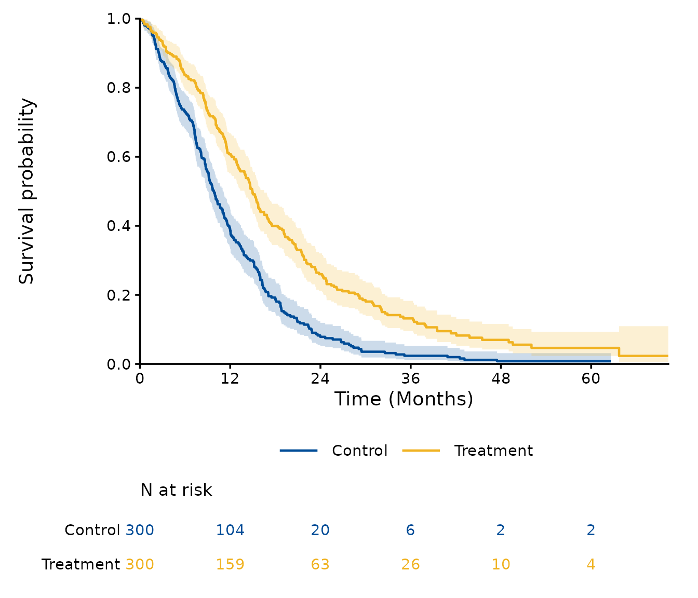
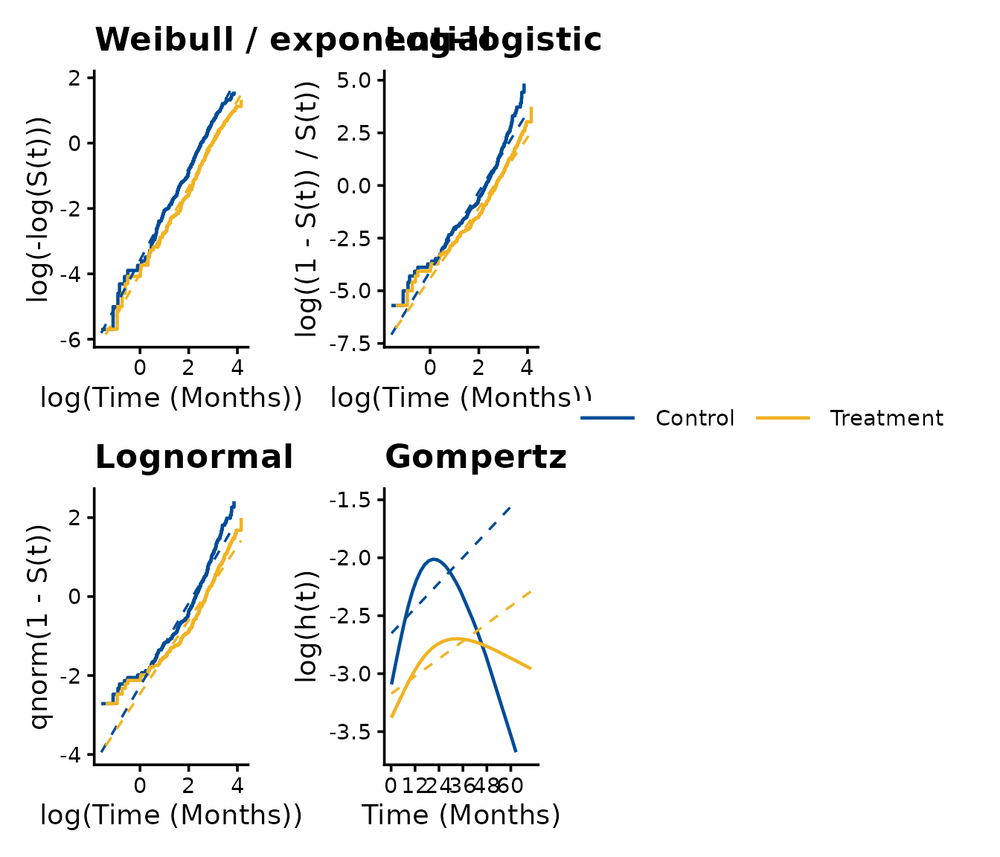
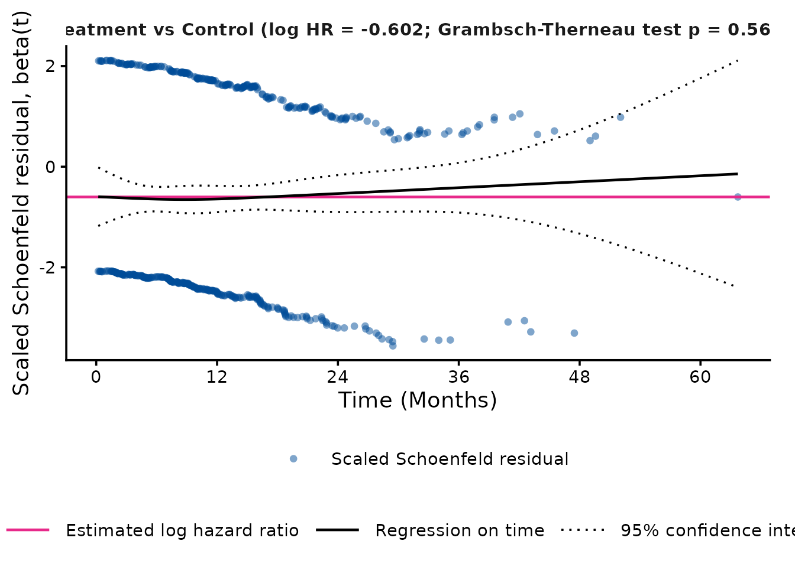
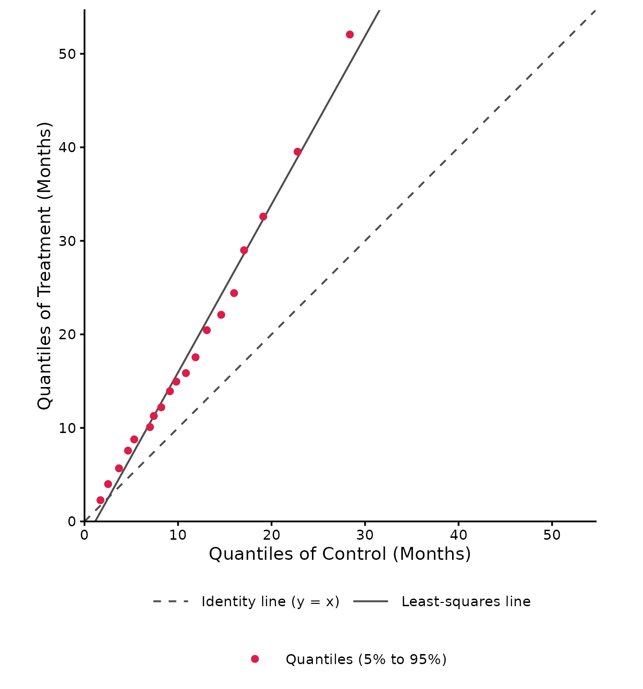
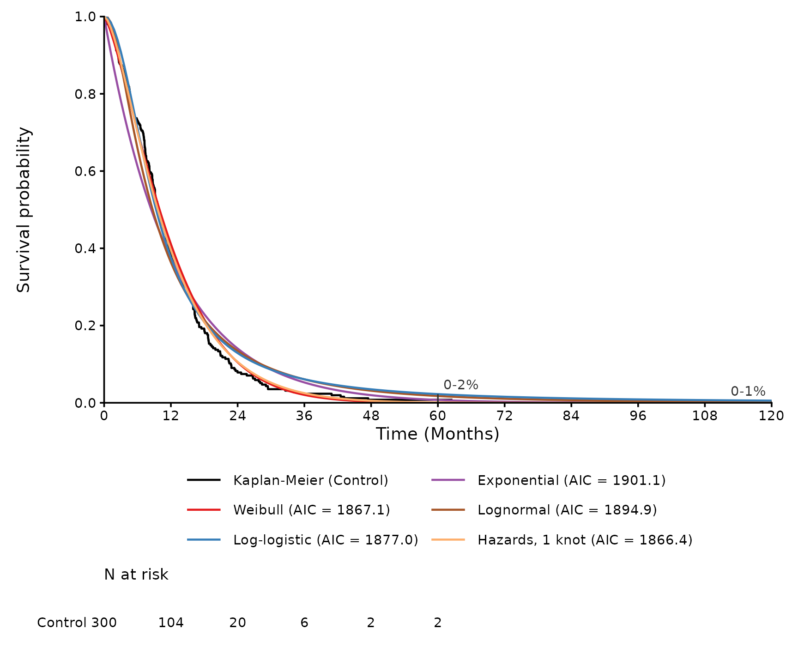
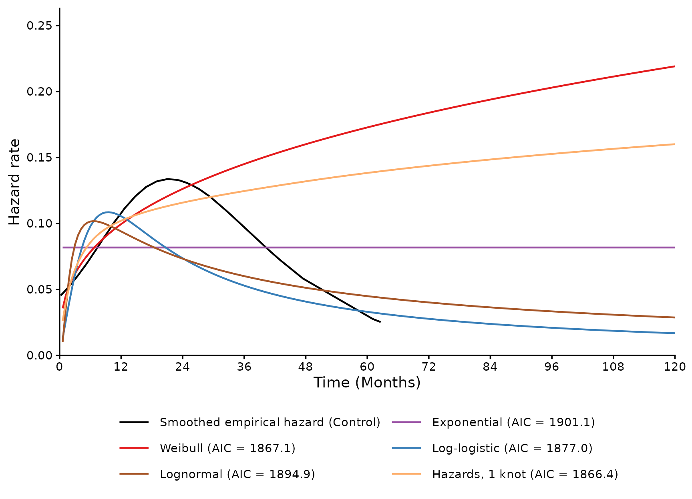

# Getting started with SurvFitSummary

``` r

library(SurvFitSummary)
```

SurvFitSummary carries out the survival analyses that inform the inputs
of cost-effectiveness models for health technology assessment: it
summarises time-to-event data, fits the standard parametric models of
NICE DSU Technical Support Document 14 and Royston-Parmar spline models
to each treatment arm and to the arms together, extrapolates the
survival beyond the follow-up, and writes the results to an Excel
workbook and a Word report. This vignette goes through these steps with
the example data of the package. The models are described in more detail
in
[`vignette("models", package = "SurvFitSummary")`](https://gosukehommaEX.github.io/SurvFitSummary/articles/models.md),
and the validation of the package in
[`vignette("validation", package = "SurvFitSummary")`](https://gosukehommaEX.github.io/SurvFitSummary/articles/validation.md).

## Data

The example data `fit_example.csv` were simulated for two arms of 300
patients, with the time to event in months (`AVAL`) and a censoring
indicator (`CNSR`, 1 = censored).
[`processing_dataset()`](https://gosukehommaEX.github.io/SurvFitSummary/reference/processing_dataset.md)
reads a data frame or a file (CSV, Excel, SAS or SAS transport), renames
the columns to `ARM`, `SURVTIME` and `EVENT`, checks the values, and
sets the control arm as the first level of `ARM`.

``` r

path <- system.file("extdata", "fit_example.csv", package = "SurvFitSummary")
dat <- processing_dataset(path, column_arm = "TRT01P",
                          column_survtime = "AVAL", column_cnsr = "CNSR",
                          control_arm = "Control")
head(dat)
#>       ARM SURVTIME EVENT
#> 1 Control  62.6170     0
#> 2 Control   9.2781     1
#> 3 Control   9.9689     1
#> 4 Control  10.6365     1
#> 5 Control  35.1569     1
#> 6 Control   7.2888     1
smry <- summarise_data(dat)
smry
#>         ARM   n events censored  median median_lcl median_ucl max_followup
#> 1   Control 300    271       29  9.8152     9.0567    11.0065      62.6170
#> 2 Treatment 300    240       60 14.9464    13.8930    16.5011      70.2602
#> 3   Overall 600    511       89 11.9142    11.1882    13.1276      70.2602
```

The control arm has 300 patients with 271 events and a median time to
event of 9.8 months (95% CI 9.1 to 11.0); the treatment arm has 240
events and a median of 14.9 months (95% CI 13.9 to 16.5).

## Kaplan-Meier estimates, hazard ratio and proportional hazards

[`km_table()`](https://gosukehommaEX.github.io/SurvFitSummary/reference/km_table.md)
gives the Kaplan-Meier estimates with their standard errors and
confidence intervals and the numbers at risk at regular times, and
[`plot_km()`](https://gosukehommaEX.github.io/SurvFitSummary/reference/plot_km.md)
draws the curves with the numbers at risk; each curve ends at the last
observed time of its arm.

``` r

km <- km_table(dat, interval = 12)
head(km)
#>       ARM time n_risk n_event n_censor        surv          se         lcl
#> 1 Control    0    300       0        0 1.000000000 0.000000000 1.000000000
#> 2 Control   12    104     173       23 0.385418910 0.029195580 0.332241811
#> 3 Control   24     20      80        4 0.078422012 0.016689801 0.051675533
#> 4 Control   36      6      14        0 0.023526604 0.009468082 0.010690559
#> 5 Control   48      2       4        0 0.007842201 0.005519108 0.001974184
#> 6 Control   60      2       0        0 0.007842201 0.005519108 0.001974184
#>          ucl
#> 1 1.00000000
#> 2 0.44710729
#> 3 0.11901207
#> 4 0.05177476
#> 5 0.03115217
#> 6 0.03115217
```

``` r

plot_km(dat, conf_int = TRUE)
```



``` r

hr <- estimate_hazard_ratio(dat)
hr
#>                      model covariates strata           comparison        hr
#> 1 Unadjusted, unstratified       None   None Treatment vs Control 0.5477552
#>         lcl       ucl      p_value   n events
#> 1 0.4586977 0.6541034 2.953589e-11 600    511
ph <- test_proportional_hazards(dat)
ph
#>             comparison     log_hr     chisq df   p_value
#> 1 Treatment vs Control -0.6019269 0.3369129  1 0.5616166
```

The Cox model without adjustment gives a hazard ratio of 0.55 (95% CI
0.46 to 0.65) for Treatment vs Control. The Grambsch-Therneau test of
the proportional hazards assumption gives p = 0.562. Covariates and
strata of the data can be added with the arguments `covariates` and
`strata` of
[`estimate_hazard_ratio()`](https://gosukehommaEX.github.io/SurvFitSummary/reference/estimate_hazard_ratio.md).

## Diagnostics

The transformations of the Kaplan-Meier estimate that are linear in log
time for the Weibull, log-logistic and lognormal distributions, and the
log of the smoothed hazard that is linear in time for the Gompertz
distribution, indicate which distributions may describe each arm. The
scaled Schoenfeld residuals and the quantile-quantile plot of the two
arms show whether the hazards are proportional and whether the arms
differ by a factor on the time scale (accelerated failure time).

``` r

plot_distribution_diagnostics(dat)
```



``` r

plot_schoenfeld(dat)
```



``` r

plot_qq_survival(dat)
```



## Fitting the models

[`fit_survival_models()`](https://gosukehommaEX.github.io/SurvFitSummary/reference/fit_survival_models.md)
fits, by default, the seven standard distributions of NICE DSU TSD 14
and the spline models on the hazard, odds and normal scales with 1 to 3
internal knots, to each arm (independent fits) and to both arms with the
arm as a covariate (dependent fits). A model that fails or warns is
recorded with its message, and the other models are still fitted.

``` r

fits <- fit_survival_models(dat)
fits
#> Survival models fitted with SurvFitSummary (time unit: months)
#> Fits: Control (independent), Treatment (independent), Both arms (dependent)
#> 48 models: 48 without problems, 0 with warnings, 0 failed
```

16 models were fitted to each of the 3 data sets, 48 fits in all.
[`gof_table()`](https://gosukehommaEX.github.io/SurvFitSummary/reference/gof_table.md)
sorts the models of each fit by AIC: the lowest AIC is that of the Odds,
2 knots model for the control arm, the Odds, 1 knot model for the
treatment arm, and the Hazards, 3 knots model for both arms.

``` r

head(gof[gof$arm == "Control", ], 6)
#>      fit_type     arm            model   n events npars    loglik      AIC
#> 1 independent Control    Odds, 2 knots 300    271     4 -925.9856 1859.971
#> 2 independent Control   Normal, 1 knot 300    271     3 -927.0389 1860.078
#> 3 independent Control    Odds, 3 knots 300    271     5 -925.2354 1860.471
#> 4 independent Control     Odds, 1 knot 300    271     3 -927.5223 1861.045
#> 5 independent Control  Normal, 3 knots 300    271     5 -925.6227 1861.245
#> 6 independent Control Hazards, 3 knots 300    271     5 -926.0461 1862.092
#>        BIC
#> 1 1874.786
#> 2 1871.189
#> 3 1878.990
#> 4 1872.156
#> 5 1879.764
#> 6 1880.611
```

## Extrapolation

The models agree within the follow-up but can differ widely beyond it,
which is why the choice of the model for a cost-effectiveness model
rests on the plausibility of the extrapolation as well as on the fit.
[`predict_survival()`](https://gosukehommaEX.github.io/SurvFitSummary/reference/predict_survival.md)
gives the survival (or the hazard) of each model at given times, with
the Kaplan-Meier estimate where the data reach.

``` r

pred <- predict_survival(fits, times = c(12, 60, 120))
ctrl_pred <- pred[pred$fit_type == "independent" & pred$arm == "Control", ]
head(ctrl_pred[ctrl_pred$time == 120, c("model", "time", "est", "km")], 8)
#>                model time          est km
#> 3        Exponential  120 5.478425e-05 NA
#> 6            Weibull  120 3.140832e-09 NA
#> 9          Lognormal  120 2.093558e-03 NA
#> 12      Log-logistic  120 5.613643e-03 NA
#> 15          Gompertz  120 2.653433e-14 NA
#> 18 Generalized Gamma  120 8.606342e-07 NA
#> 21             Gamma  120 3.717499e-07 NA
#> 24   Hazards, 1 knot  120 1.294723e-07 NA
```

For the control arm, the survival at 10 years ranges from 0.000 to 0.006
across the 16 models. In the plot of the fitted survival curves,
`range_times` marks the range of the models plotted at given times (here
5 and 10 years), labelled in percent, as in the plots of the spline
models in the Word report.

``` r

plot_survival_fits(fits, arms = "Control",
                   models = c("Exponential", "Weibull", "Log-logistic",
                              "Lognormal", "Hazards, 1 knot"),
                   time_horizon = 120, range_times = c(60, 120))
```



``` r

plot_hazard_fits(fits, arms = "Control",
                 models = c("Exponential", "Weibull", "Log-logistic",
                            "Lognormal", "Hazards, 1 knot"),
                 time_horizon = 120)
```



The legend is below the plot by default; `legend_position = "right"` (or
`"top"`, `"left"`, `"none"`) places it elsewhere, in all the plots of
the package.

## Excel workbook and Word report

[`write_survival_workbook()`](https://gosukehommaEX.github.io/SurvFitSummary/reference/write_survival_workbook.md)
writes the tables of the analysis to an Excel workbook, one table per
sheet: the data summary, the Kaplan-Meier table, the hazard ratios, the
proportional hazards test, the status of the models, the fit statistics,
the parameters on the natural and transformed scales with the rows of
their covariance matrices, the covariance matrices and their Cholesky
factors, the survival summary, the predicted survival at the landmark
times and the knots of the spline models.

``` r

workbook <- tempfile(fileext = ".xlsx")
write_survival_workbook(fits, workbook, conf_int = FALSE)
file.exists(workbook)
#> [1] TRUE
unlink(workbook)
```

[`write_survival_report()`](https://gosukehommaEX.github.io/SurvFitSummary/reference/write_survival_report.md)
writes a Word report with the methods, the diagnostics, the fits of the
standard parametric and spline models with their tables and figures
(with and without confidence intervals), and the extrapolations. With
all the models it takes a few minutes, because each figure is drawn as
an image.

``` r

write_survival_report(fits, "survival_report.docx",
                      outcome = "Overall survival")
```
