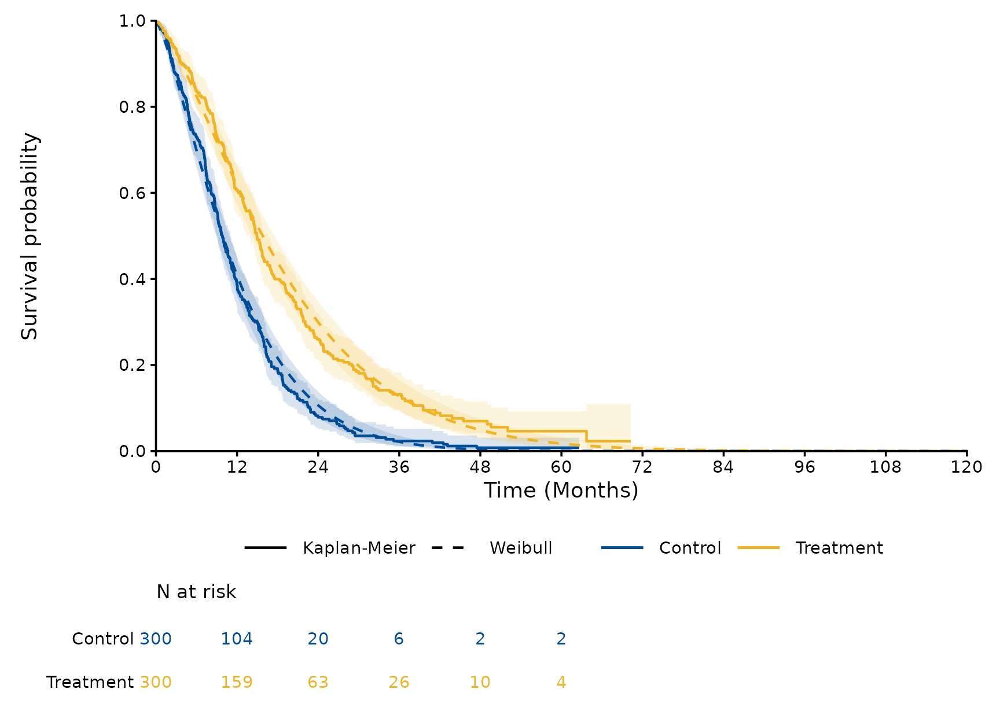
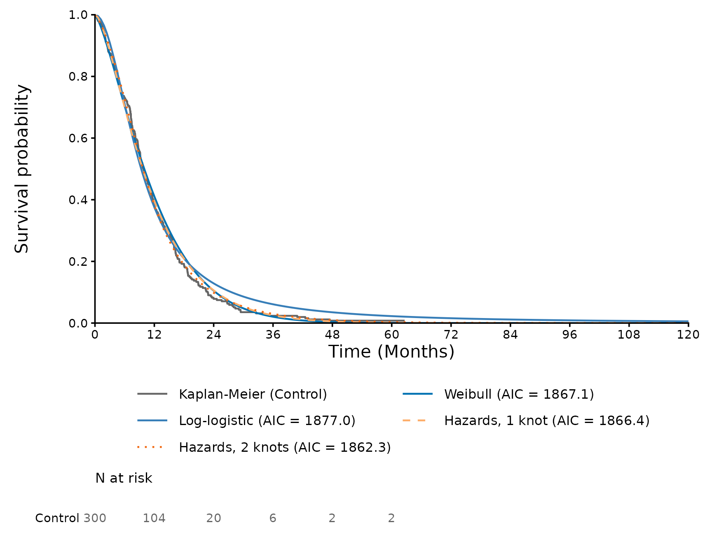

# Parametric and spline models

``` r

library(SurvFitSummary)
dat <- processing_dataset(
  system.file("extdata", "fit_example.csv", package = "SurvFitSummary"),
  column_arm = "TRT01P", column_survtime = "AVAL", column_cnsr = "CNSR",
  control_arm = "Control"
)
f2 <- function(x) sprintf("%.2f", x)
f3 <- function(x) sprintf("%.3f", x)
```

This vignette describes the models of
[`fit_survival_models()`](https://gosukehommaEX.github.io/SurvFitSummary/reference/fit_survival_models.md)
and the tables derived from them. The data are those of
[`vignette("SurvFitSummary", package = "SurvFitSummary")`](https://gosukehommaEX.github.io/SurvFitSummary/articles/SurvFitSummary.md).

## Distributions

The parametric models are fitted with
[`flexsurv::flexsurvreg()`](http://chjackson.github.io/flexsurv-dev/reference/flexsurvreg.md),
with the parameters of flexsurv. The default is the seven standard
models of NICE DSU Technical Support Document 14 (marked with \*).

| Code | Model | Parameters (natural scale) | Location parameter |
|----|----|----|----|
| `"exp"` \* | Exponential | rate | rate |
| `"weibull"` \* | Weibull (accelerated failure time form) | shape, scale | scale |
| `"weibullPH"` | Weibull (proportional hazards form) | shape, scale | scale |
| `"rayleigh"` | Rayleigh (Weibull with shape 2) | scale | scale |
| `"lnorm"` \* | Lognormal | meanlog, sdlog | meanlog |
| `"llogis"` \* | Log-logistic | shape, scale | scale |
| `"gompertz"` \* | Gompertz | shape, rate | rate |
| `"gamma"` \* | Gamma | shape, rate | rate |
| `"gengamma"` \* | Generalized gamma (Prentice 1974) | mu, sigma, Q | mu |
| `"gengamma.orig"` | Generalized gamma (Stacy 1962) | shape, scale, k | scale |
| `"genf"` | Generalized F (Prentice 1975) | mu, sigma, Q, P | mu |
| `"genf.orig"` | Generalized F (original form) | mu, sigma, s1, s2 | mu |

The spline models of Royston and Parmar (2002) are fitted with
[`flexsurv::flexsurvspline()`](http://chjackson.github.io/flexsurv-dev/reference/flexsurvspline.md).
They model the log cumulative hazard (scale `"hazard"`), the log
cumulative odds (`"odds"`) or the probit of the survival (`"normal"`) as
a natural cubic spline of log time with parameters `gamma0`, `gamma1`,
…; without internal knots they reduce to the Weibull, log-logistic and
lognormal models. The boundary knots are the smallest and largest log
event times, and the internal knots are by default at equally spaced
quantiles of the log event times.

## Independent and dependent fits

Each arm is fitted separately (`fit_type = "independent"`), and the arms
are fitted together with the arm as a covariate of the location
parameter on its transformed scale (`fit_type = "dependent"`, labelled
`"Both arms"`); for the spline models the arm shifts `gamma0`.

``` r

fits <- fit_survival_models(dat, distributions = c("weibull", "llogis"),
                            spline_scales = "hazard", spline_knots = 1:2)
par <- parameter_table(fits)
par[par$fit_type == "dependent" & par$model == "Weibull", ]
#>     fit_type       arm   model    parameter       scale        est        lcl
#> 45 dependent Both arms Weibull        shape     natural  1.3232955  1.2391598
#> 46 dependent Both arms Weibull        scale     natural 13.0430475 11.8996408
#> 47 dependent Both arms Weibull ARMTreatment     natural  0.4687628  0.3373236
#> 48 dependent Both arms Weibull        shape transformed  0.2801252  0.2144336
#> 49 dependent Both arms Weibull        scale transformed  2.5682552  2.4765082
#> 50 dependent Both arms Weibull ARMTreatment transformed  0.4687628  0.3373236
#>           ucl         se
#> 45  1.4131438 0.04435257
#> 46 14.2963213 0.61055241
#> 47  0.6002020 0.06706205
#> 48  0.3458168 0.03351675
#> 49  2.6600023 0.04681056
#> 50  0.6002020 0.06706205
```

In the dependent Weibull model the treatment multiplies the scale, that
is the time to any given survival, by exp(0.469) = 1.60 (95% CI 1.40 to
1.82). The natural scale is that of flexsurv; on the transformed scale
the positive parameters are on the log scale, which is the scale of the
covariance matrices and of the simulations below.

## Knots of the spline models

[`spline_knot_table()`](https://gosukehommaEX.github.io/SurvFitSummary/reference/spline_knot_table.md)
gives the internal knots of each fit with the number at risk and the
Kaplan-Meier estimate at each knot, which shows how much data supports
each part of the spline.

``` r

spline_knot_table(fits)
#>      fit_type       arm n_knots knot  quantile log_time      time n_risk
#> 1 independent   Control       1    1 0.5000000 2.243398  9.425300    145
#> 2 independent   Control       2    1 0.3333333 1.969362  7.166100    191
#> 3 independent   Control       2    2 0.6666667 2.542782 12.715000     97
#> 4 independent Treatment       1    1 0.5000000 2.587478 13.296201    147
#> 5 independent Treatment       2    1 0.3333333 2.288967  9.864741    190
#> 6 independent Treatment       2    2 0.6666667 2.861626 17.489943    100
#> 7   dependent Both arms       1    1 0.5000000 2.411520 11.150900    292
#> 8   dependent Both arms       2    1 0.3333333 2.085771  8.050800    382
#> 9   dependent Both arms       2    2 0.6666667 2.727997 15.302200    198
#>    surv_est    surv_se
#> 1 0.5205484 0.02978855
#> 2 0.6830815 0.02752297
#> 3 0.3557713 0.02876996
#> 4 0.5615273 0.03019978
#> 5 0.7134789 0.02717195
#> 6 0.4037366 0.03033069
#> 7 0.5421976 0.02118619
#> 8 0.6990478 0.01930597
#> 9 0.3808919 0.02090650
```

Knots can also be given on the time scale, one vector per spline model;
the vectors must have different numbers of knots, and the knots must lie
between the smallest and largest event times of every fit.

``` r

fits_knots <- fit_survival_models(dat, distributions = NULL,
                                  spline_scales = "odds",
                                  knots = list(12, c(6, 18)))
gof_table(fits_knots)
#>      fit_type       arm         model   n events npars     loglik      AIC
#> 1 independent   Control Odds, 2 knots 300    271     4  -925.9283 1859.857
#> 2 independent   Control  Odds, 1 knot 300    271     3  -927.2485 1860.497
#> 3 independent Treatment  Odds, 1 knot 300    240     3  -943.8827 1893.765
#> 4 independent Treatment Odds, 2 knots 300    240     4  -943.9062 1895.812
#> 5   dependent Both arms  Odds, 1 knot 600    511     4 -1873.7053 3755.411
#> 6   dependent Both arms Odds, 2 knots 600    511     5 -1873.6248 3757.250
#>        BIC
#> 1 1874.672
#> 2 1871.608
#> 3 1904.877
#> 4 1910.628
#> 5 3772.998
#> 6 3779.234
```

## Covariance matrices and Cholesky factors

The covariance matrix of the estimates and its lower triangular Cholesky
factor L, with L L’ equal to the covariance matrix, are given on the
transformed and natural scales. A probabilistic sensitivity analysis
draws parameter vectors as the estimate plus L z, with z standard
normal, on the transformed scale.

``` r

covariance_table(fits, scale = "transformed")[1:4, ]
#>      fit_type     arm   model       scale   row   col        value
#> 1 independent Control Weibull transformed shape shape 0.0020457891
#> 2 independent Control Weibull transformed shape scale 0.0005688729
#> 3 independent Control Weibull transformed scale shape 0.0005688729
#> 4 independent Control Weibull transformed scale scale 0.0022048687
chol <- covariance_table(fits, type = "cholesky", scale = "transformed")
rows <- chol$fit_type == "independent" & chol$arm == "Control" &
  chol$model == "Weibull"
L <- matrix(chol$value[rows], nrow = 2, byrow = TRUE,
            dimnames = list(unique(chol$row[rows]), unique(chol$col[rows])))
L
#>            shape      scale
#> shape 0.04523040 0.00000000
#> scale 0.01257722 0.04524027
est <- par[par$fit_type == "independent" & par$arm == "Control" &
             par$model == "Weibull" & par$scale == "transformed", ]
mu <- est$est[match(rownames(L), est$parameter)]
set.seed(1)
draws <- mu + L %*% matrix(stats::rnorm(2 * 10000), nrow = 2)
# Natural scale: shape and scale
summary(t(exp(draws)))
#>      shape           scale      
#>  Min.   :1.152   Min.   :10.72  
#>  1st Qu.:1.301   1st Qu.:12.69  
#>  Median :1.341   Median :13.09  
#>  Mean   :1.343   Mean   :13.11  
#>  3rd Qu.:1.384   3rd Qu.:13.51  
#>  Max.   :1.595   Max.   :15.62
```

The variances of the 10000 draws, 2.085 and 2.184 (times 1000),
reproduce those of the covariance matrix, 2.046 and 2.205.

## Predictions with confidence intervals

[`predict_survival()`](https://gosukehommaEX.github.io/SurvFitSummary/reference/predict_survival.md)
gives the survival, the hazard or the cumulative hazard of each model.
With `conf_int = TRUE` the confidence limits are the quantiles of the
predictions for `n_sim` parameter vectors drawn from the asymptotic
normal distribution of the estimates; the seed is set for each model and
arm, so that the limits do not depend on the other models, and the
random number generator of the session is left unchanged.

``` r

pred <- predict_survival(fits, times = c(12, 60), conf_int = TRUE)
pred[pred$fit_type == "independent" & pred$arm == "Control", ]
#>      fit_type     arm            model time          est          lcl
#> 1 independent Control          Weibull   12 0.4109409831 3.650270e-01
#> 2 independent Control          Weibull   60 0.0004441375 8.700272e-05
#> 3 independent Control     Log-logistic   12 0.3757980221 3.283578e-01
#> 4 independent Control     Log-logistic   60 0.0225047906 1.464361e-02
#> 5 independent Control  Hazards, 1 knot   12 0.3953930753 3.450085e-01
#> 6 independent Control  Hazards, 1 knot   60 0.0010588679 1.517155e-04
#> 7 independent Control Hazards, 2 knots   12 0.3819794299 3.323450e-01
#> 8 independent Control Hazards, 2 knots   60 0.0032387340 4.723562e-04
#>           ucl          km
#> 1 0.457718923 0.385418910
#> 2 0.001781766 0.007842201
#> 3 0.425490508 0.385418910
#> 4 0.034205032 0.007842201
#> 5 0.446406431 0.385418910
#> 6 0.004622649 0.007842201
#> 7 0.436677584 0.385418910
#> 8 0.012702213 0.007842201
```

The Weibull model of the control arm predicts a survival of 0.000 at 5
years (95% CI 0.000 to 0.002).
[`survival_summary()`](https://gosukehommaEX.github.io/SurvFitSummary/reference/survival_summary.md)
gives the median, the mean and the restricted mean survival up to a time
horizon.

``` r

survival_summary(fits, time_horizon = 60)
#>       fit_type       arm            model    median median_lcl median_ucl
#> 1  independent   Control          Weibull  9.967365         NA         NA
#> 2  independent   Control     Log-logistic  9.343595         NA         NA
#> 3  independent   Control  Hazards, 1 knot  9.650366         NA         NA
#> 4  independent   Control Hazards, 2 knots  9.712365         NA         NA
#> 5  independent Treatment          Weibull 15.677837         NA         NA
#> 6  independent Treatment     Log-logistic 14.573687         NA         NA
#> 7  independent Treatment  Hazards, 1 knot 15.253530         NA         NA
#> 8  independent Treatment Hazards, 2 knots 14.910509         NA         NA
#> 9    dependent   Control          Weibull  9.887639         NA         NA
#> 10   dependent Treatment          Weibull 15.800605         NA         NA
#> 11   dependent   Control     Log-logistic  9.333603         NA         NA
#> 12   dependent Treatment     Log-logistic 14.559850         NA         NA
#> 13   dependent   Control  Hazards, 1 knot  9.658265         NA         NA
#> 14   dependent Treatment  Hazards, 1 knot 15.211906         NA         NA
#> 15   dependent   Control Hazards, 2 knots  9.956673         NA         NA
#> 16   dependent Treatment Hazards, 2 knots 14.586327         NA         NA
#>        mean mean_lcl mean_ucl     rmst rmst_lcl rmst_ucl
#> 1  12.02017       NA       NA 12.01768       NA       NA
#> 2  14.47807       NA       NA 13.14450       NA       NA
#> 3  12.00392       NA       NA 11.99644       NA       NA
#> 4  12.04455       NA       NA 12.00869       NA       NA
#> 5  19.19071       NA       NA 18.98189       NA       NA
#> 6  24.49935       NA       NA 19.81651       NA       NA
#> 7  19.27185       NA       NA 18.96520       NA       NA
#> 8  19.77750       NA       NA 18.93399       NA       NA
#> 9  12.00441       NA       NA 12.00129       NA       NA
#> 10 19.18324       NA       NA 18.99793       NA       NA
#> 11 15.01128       NA       NA 13.37056       NA       NA
#> 12 23.41668       NA       NA 19.54864       NA       NA
#> 13 11.99880       NA       NA 11.99062       NA       NA
#> 14 19.28333       NA       NA 18.96689       NA       NA
#> 15 12.01427       NA       NA 11.97809       NA       NA
#> 16 19.86130       NA       NA 18.96952       NA       NA
```

``` r

plot_survival_fits(fits, models = "Weibull", fit_type = "dependent",
                   conf_int = TRUE, time_horizon = 120)
```



## Comparing the models

[`gof_table()`](https://gosukehommaEX.github.io/SurvFitSummary/reference/gof_table.md)
gives the log-likelihood, AIC and BIC of each model, sorted by AIC
within each fit; the number of patients is used for the BIC. The fit
statistics compare the models within the follow-up only, so that the
plausibility of the extrapolation is judged separately, for example from
the hazard functions and from external data.

``` r

gof_table(fits)
#>       fit_type       arm            model   n events npars     loglik      AIC
#> 1  independent   Control Hazards, 2 knots 300    271     4  -927.1436 1862.287
#> 2  independent   Control  Hazards, 1 knot 300    271     3  -930.1778 1866.356
#> 3  independent   Control          Weibull 300    271     2  -931.5666 1867.133
#> 4  independent   Control     Log-logistic 300    271     2  -936.5067 1877.013
#> 5  independent Treatment Hazards, 2 knots 300    240     4  -943.4353 1894.871
#> 6  independent Treatment          Weibull 300    240     2  -948.2785 1900.557
#> 7  independent Treatment  Hazards, 1 knot 300    240     3  -947.5741 1901.148
#> 8  independent Treatment     Log-logistic 300    240     2  -950.0985 1904.197
#> 9    dependent Both arms Hazards, 2 knots 600    511     5 -1870.6875 3751.375
#> 10   dependent Both arms  Hazards, 1 knot 600    511     4 -1877.6487 3763.297
#> 11   dependent Both arms          Weibull 600    511     3 -1879.9570 3765.914
#> 12   dependent Both arms     Log-logistic 600    511     3 -1887.1406 3780.281
#>         BIC
#> 1  1877.102
#> 2  1877.467
#> 3  1874.541
#> 4  1884.421
#> 5  1909.686
#> 6  1907.965
#> 7  1912.260
#> 8  1911.605
#> 9  3773.360
#> 10 3780.885
#> 11 3779.105
#> 12 3793.472
```

## Models that fail

A model that fails or warns does not stop the others: its status
(`"ok"`, `"warning"` or `"error"`) and message are kept in
`fits$models`, printed by
[`print()`](https://rdrr.io/r/base/print.html), written to the sheet
“Model status” of the workbook and listed in the report.

``` r

fits$models[, c("fit_type", "arm", "model", "status", "message")]
#>       fit_type       arm            model status message
#> 1  independent   Control          Weibull     ok    <NA>
#> 2  independent   Control     Log-logistic     ok    <NA>
#> 3  independent   Control  Hazards, 1 knot     ok    <NA>
#> 4  independent   Control Hazards, 2 knots     ok    <NA>
#> 5  independent Treatment          Weibull     ok    <NA>
#> 6  independent Treatment     Log-logistic     ok    <NA>
#> 7  independent Treatment  Hazards, 1 knot     ok    <NA>
#> 8  independent Treatment Hazards, 2 knots     ok    <NA>
#> 9    dependent Both arms          Weibull     ok    <NA>
#> 10   dependent Both arms     Log-logistic     ok    <NA>
#> 11   dependent Both arms  Hazards, 1 knot     ok    <NA>
#> 12   dependent Both arms Hazards, 2 knots     ok    <NA>
```

The likelihood is maximised by
[`stats::optim()`](https://rdrr.io/r/stats/optim.html) (BFGS) with the
settings in `control`; the default tolerance (`reltol = 1e-10`) is
smaller than that of [`optim()`](https://rdrr.io/r/stats/optim.html).
flexsurv has no analytic gradient for the spline models on the normal
scale, for which the step of the numerical gradient is `ndeps = 1e-5`
unless `control` sets it.

## Colours, line types and text sizes of the plots

The plots take the colours and line types of the arms, curves or
elements they draw in `colours` and `linetypes`, and font sizes in
points in `text_sizes`. A named vector changes the entries it names and
the others keep their defaults; an unnamed vector gives one value per
entry, in the order of the legend. For the fitted curves of one arm, the
names are the labels of the models and `"Kaplan-Meier"` (or
`"Smoothed empirical hazard"` in
[`plot_hazard_fits()`](https://gosukehommaEX.github.io/SurvFitSummary/reference/plot_hazard_fits.md)).

``` r

plot_survival_fits(fits, arms = "Control", time_horizon = 120,
                   colours = c("Kaplan-Meier" = "grey40",
                               "Weibull" = "#009E73"),
                   linetypes = c("Hazards, 1 knot" = "dashed",
                                 "Hazards, 2 knots" = "dotted"),
                   text_sizes = c(axis_title = 16, legend = 12))
```



## References

Latimer NR (2011, updated 2013). NICE DSU Technical Support Document 14:
Survival analysis for economic evaluations alongside clinical trials -
extrapolation with patient-level data.

Royston P, Parmar MKB (2002). Flexible parametric proportional-hazards
and proportional-odds models for censored survival data, with
application to prognostic modelling and estimation of treatment effects.
Statistics in Medicine 21(15):2175-2197.
